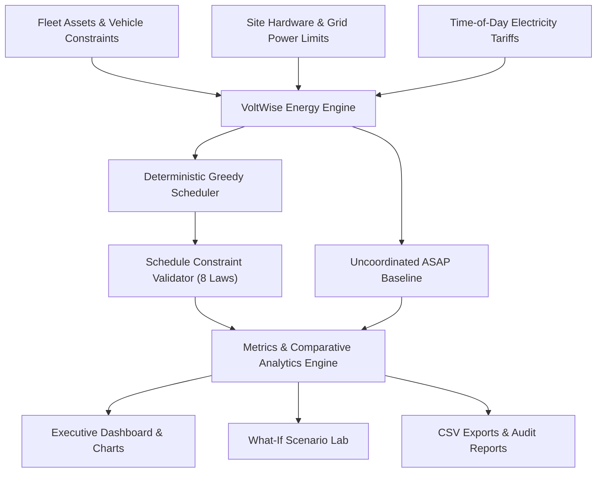

# VoltWise ⚡
### Intelligent EV Fleet Charging Optimisation Platform
**"Charge Smarter. Reduce Peak Demand. Drive a Cleaner Future."**

[](#sdg-mapping)
[](#sdg-mapping)
[](tests.html)
[](LICENSE)

---

## 1. Problem Statement
Commercial fleet operators (e.g. delivery logistics vans, urban municipal shuttles, utility service fleets) are rapidly transitioning from internal combustion engines to electric vehicles (EVs). However, when a fleet returns to a commercial depot at the end of the business day (typically around **18:00**), plugging all vehicles in simultaneously creates severe operational and financial crises:
1. **Catastrophic Peak Demand Spikes:** Concurrent charging across high-power chargers can easily exceed the depot transformer's physical capacity limit (e.g., 60 kW), risking utility penalties or transformer trip-outs.
2. **Coincidence with Peak Electricity Tariffs:** The evening return window (18:00–21:00) coincides with the regional electrical grid's highest Time-of-Day (TOD) tariff rates (e.g. ₹9.50/kWh vs. ₹3.60/kWh overnight). Uncoordinated charging concentrates electricity consumption into the most expensive time of day.
3. **Hardware Contention & Departure Deadlines:** Depots frequently possess fewer chargers than vehicles (e.g., 4 chargers for 8 EVs). Vehicles have varying battery capacities, initial States of Charge (SOC), charging power limits, and departure deadlines the following morning.

---

## 2. Proposed Solution
**VoltWise** is an open, browser-based energy optimization and fleet scheduling platform. It calculates each vehicle's precise energy requirements, respects physical site grid capacity limits, accounts for time-varying electricity tariffs, and generates a physically verifiable, conflict-free charging schedule.

It compares the optimized schedule against a standard **Uncoordinated Baseline (ASAP / Earliest Deadline First)** and provides transparent accounting of:
- Total electricity cost in INR (₹) and percentage savings.
- Peak depot grid demand in kW and demand reduction.
- Guaranteed vehicle departure deadline compliance.
- Honest tracking of unfulfilled energy if constraints are exceeded.
- Avoided peak grid energy shifted into overnight valley (SDG 7).
- Clean electric transit kilometers powered without tailpipe emissions (SDG 11).
- Estimated greenhouse gas emissions in kg CO₂e.

---

## 3. United Nations Sustainable Development Goals (SDG) Mapping

### Primary: SDG 7 — Affordable and Clean Energy
- **Target 7.3:** Double the global rate of improvement in energy efficiency.
- **VoltWise Contribution:** By smoothing commercial fleet power demand and shifting flexible charging into overnight low-demand grid valleys, VoltWise eliminates avoidable peak demand spikes. This maximizes the utilization of existing electrical distribution assets without requiring costly sub-station expansions.

### Secondary: SDG 11 — Sustainable Cities and Communities
- **Target 11.2 & 11.6:** Provide access to sustainable transport systems and reduce municipal environmental impact.
- **VoltWise Contribution:** Facilitates reliable electrification of commercial logistics and public transit fleets by ensuring all vehicles reach required SOC thresholds by morning departure times.

---

## 4. Key Features
1. **EV Fleet Command Centre:**
   - Real-time status ribbon summarizing connected EVs, departure readiness %, peak grid connection loading, and avoided peak energy.
   - Clean, user-driven data model with zero placeholders by default (clean empty depot on launch, with optional template loader).
2. **Interactive 48-Slot Vehicle & Cart Heatmap:**
   - 48-slot visual grid (15-min intervals from 18:00 to 06:00) with color-coded power intensity levels (Idle, Low 1–7.4 kW, Medium 7.5–15 kW, High Fast 15–22 kW, Ultra >22 kW).
   - Target reached markers (`✓`) and departure deadline indicators (`🏁`).
   - Rich interactive hover popovers showing power, energy delivered, tariff price, cost, and remaining deficit.
   - Multi-dimensional filters: Group by Vehicles vs Group by Chargers, vehicle filter, charger filter, active charging filter, and time window presets.
3. **Real-Time Style Charging Timeline Simulator:**
   - Interactive 15-minute time scrubber and auto-player stepping through $t = 0 \dots 47$.
   - Live charger bay cards showing pulsing power indicators, real-time vehicle battery SOC progression, and instantaneous depot load gauge.
4. **Smart Charging Decision Explanations:**
   - Transparent, explainable algorithmic decision trail for every scheduled vehicle.
   - Breaks down exact urgency slack calculations, Time-of-Day tariff economics, hardware bay assignments, and site capacity compliance.
5. **What-If Emergency Simulator:**
   - 5 operational disruption presets: 50% grid curtailment, charger bay outage, early morning rush deployment (-2 hours), tariff spike (₹16/kWh), and unplanned fleet surge.
   - Instant delta impact analysis calculating cost difference, peak demand shift, and completion rates.
6. **Departure Deadline Risk Indicators:**
   - Evaluates operational feasibility for each vehicle: 🟢 Safe, 🟡 Moderate, 🔴 Critical, or 🚨 Infeasible.
7. **Quantitative SDG Impact Dashboard:**
   - Transparent calculation of avoided peak grid energy (kWh), peak load shaved (kW and %), clean zero-emission transit distance enabled (km), and grid carbon delta.
8. **Deterministic Scheduling Engine:**
   - 15-minute discrete time slots ($T = 48$ slots across a 12-hour 18:00 to 06:00 horizon).
   - Strict mathematical enforcement of site power limits, charger exclusivity, vehicle exclusivity, and charger ratings.
9. **Infrastructure & Tariff Customization:**
   - Add, edit, clone, and toggle hardware outages for individual charger bays.
   - Customize site power capacity limits (kW), AC-DC efficiency, and grid emissions factors.
   - Interactive electricity tariff tier editor (Peak, Shoulder, Off-Peak, Morning rates in ₹/kWh).
10. **Data Portability, Backup & Reporting:**
    - JSON export and import to backup and restore full depot fleet configurations.
    - RFC 4180 compliant CSV exports for the detailed charging schedule and the baseline comparison audit.
    - Media-query print layout for PDF audit generation.
    - Local browser persistence via `localStorage`.

---

## 5. Technology Stack
- **Structure:** Semantic HTML5 with accessible form labeling and ARIA attributes.
- **Styling:** Vanilla CSS3 design system (modern light slate theme, responsive layout, print styles).
- **Core Logic:** Vanilla JavaScript (ES6+), dual-compatible with modern browsers and Node.js.
- **Visualisation:** Chart.js v4.4 via CDN with automatic fallback to summary data if offline.
- **Storage:** Browser `localStorage` with corrupted data protection.
- **Exports:** Native JavaScript `Blob` and URL Object APIs.
- **Zero Heavy Toolchains:** No npm installation, webpack, Vite, or external backend required.

---

## 6. Architecture & Data Flow



---

## 7. Mathematical & Engineering Formulations

### 1. Battery Energy Required
$$E_{\text{batt,req}} = \text{Capacity}_{\text{kWh}} \times \frac{\max(0, \text{TargetSOC}_{\%} - \text{CurrentSOC}_{\%})}{100}$$

### 2. Grid Energy Consumed (Accounting for AC/DC Efficiency Losses)
$$E_{\text{grid}} = \frac{E_{\text{batt}}}{\eta}$$
*Where $\eta = 0.90$ (90% default charging efficiency).*

### 3. Slot Energy (15-Minute Discrete Time Slots, $\Delta t = 0.25$ h)
$$E_{\text{slot,grid}} = P_{\text{allocated,kW}} \times \Delta t$$
$$E_{\text{slot,batt}} = E_{\text{slot,grid}} \times \eta$$

### 4. Total Electricity Cost
$$\text{Total Cost (₹)} = \sum_{t=0}^{T-1} \left( E_{\text{slot,grid}}(t) \times \text{Tariff}(t) \right)$$

### 5. Peak Depot Demand
$$\text{Peak Demand (kW)} = \max_{t \in [0, T-1]} \sum_{c \in \text{Chargers}} P_{c}(t)$$

### 6. Urgency Slack Formulation
$$\text{Slack}(t) = (\text{DepartureSlot} - t) - \left\lceil \frac{E_{\text{remain,batt}}(t)}{P_{\text{max}} \times \Delta t \times \eta} \right\rceil$$
- **$\text{Slack} \le 1$:** Critical deadline emergency. Charge immediately at maximum feasible power.
- **$\text{Slack} \ge 2$:** Flexible dwell time. Pause during high peak tariffs ($\ge ₹8.00$/kWh) to shift consumption into the overnight valley.

---

## 8. Physical Constraints Enforced

At every discrete slot $t$:
1. **Charger Exclusivity:** A single charger can serve at most one vehicle.
2. **Vehicle Exclusivity:** A single vehicle can connect to at most one charger.
3. **Charger Power Limit:** $P_{v,c,t} \le \text{ChargerRating}_{\text{kW}}$.
4. **Vehicle Power Limit:** $P_{v,c,t} \le \text{VehicleMaxPower}_{\text{kW}}$.
5. **Site Grid Capacity:** $\sum P_{v,c,t} \le \text{SitePowerLimit}_{\text{kW}}$.
6. **Charger Outage Status:** If charger is offline, power = 0 kW.
7. **Departure Deadline:** Charging cannot occur at or after a vehicle's departure slot.
8. **Battery Conservation:** Total delivered energy cannot exceed required energy.

---

## 9. Verification & Automated Testing

VoltWise includes an automated verification suite covering 21 comprehensive test cases:
1. Empty fleet handling
2. Vehicle already at target SOC (0 kWh needed)
3. Target SOC $\le$ Current SOC handling
4. Invalid SOC input validation
5. Invalid battery capacity validation
6. Duplicate vehicle ID detection
7. Single vehicle with single charger accuracy
8. Charger exclusivity with competing vehicles
9. Site power limit strict capping
10. Hardware charger outage avoidance
11. Impossible deadline detection with explicit cause reporting
12. Price responsiveness (load shifting away from peak tariffs)
13. Conversion efficiency loss accounting
14. Baseline vs. Optimized cost calculation
15. Peak demand concurrency calculation
16. Validator detection of charger sharing
17. Validator detection of vehicle double-charging
18. LocalStorage state serialization roundtrip
19. RFC 4180 CSV export formatting
20. Dynamic recalculation on tariff modifications
21. Full 8-vehicle default fleet physical validity audit
22. Smart Charging Decision generator explainable rationale & risk tags
23. SDG impact calculations for avoided peak grid energy and clean transit km
24. What-If 50% grid curtailment constraint compliance audit

### How to Run the Tests
#### Option A: Command Line (Node.js)
```powershell
cd voltwise
node tests.js
```
*Result: 24 Passed, 0 Failed.*

#### Option B: In the Browser
Open `tests.html` directly in Google Chrome or Microsoft Edge to view the visual test execution runner.

---

## 10. How to Run on Windows using VS Code

### Quick Start (Under 1 Minute)
1. **Open Folder in VS Code:**
   - Launch Visual Studio Code.
   - Click **File** → **Open Folder...**
   - Select your project folder containing `voltwise`.
2. **Launch with Live Server:**
   - Right-click `voltwise/index.html` in the file explorer.
   - Click **Open with Live Server** (or open `index.html` directly in any web browser by double clicking it).
3. **Explore Features:**
   - View the executive dashboard and compare the baseline vs. optimized cost.
   - Navigate to **Fleet Manager** to add or edit vehicles.
   - Test **What-If Lab** scenarios (e.g. simulate a charger outage or 30 kW site cap).
   - Export CSV audit logs or print reports from the **Reports** tab.

---

## 11. Deployment to GitHub Pages

1. Initialize a Git repository inside the `voltwise` folder (or push this repository to GitHub).
2. Create a new repository on [GitHub](https://github.com).
3. Push your files to the `main` branch:
   ```bash
   git init
   git add .
   git commit -m "Initial release of VoltWise platform"
   git branch -M main
   git remote add origin https://github.com/YOUR_USERNAME/voltwise.git
   git push -u origin main
   ```
4. On GitHub, navigate to **Settings** → **Pages**.
5. Under **Branch**, select `main` and root `/` folder, then click **Save**.
6. Your live application will be available at `https://YOUR_USERNAME.github.io/voltwise/`.

---

## 12. Limitations & Future Roadmap
- **Simulated Demonstration Data:** Default vehicle batteries and tariffs are simulated for prototype demonstration.
- **Static Arrival Assumptions:** Current prototype assumes fleet vehicles are available from slot 0 (18:00). Future iterations will support staggered arrival times throughout the evening.
- **Hardware Telemetry Integration:** Future development will integrate OCPP (Open Charge Point Protocol 2.0.1) to communicate directly with physical commercial EV charging stations.

---

## 13. Project Identity & Team Contribution
- **Project Name:** VoltWise
- **Full Title:** Intelligent EV Fleet Charging Optimisation Platform
- **Category:** Energy Technology, Sustainable Mobility, Software Engineering
- **Implementation:** Original mathematical modeling, deterministic greedy scheduling heuristic, constraint validator, and user interface developed specifically for this project.
